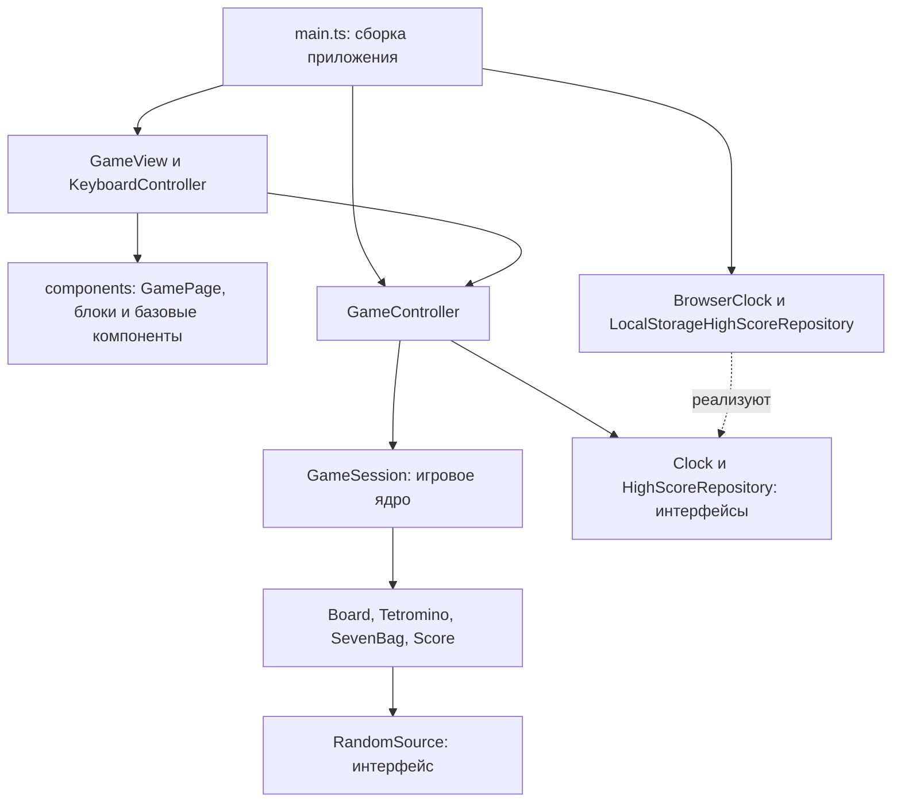

# Архитектура

Статус: архитектура целевой версии. Реализованы UI-основа и её тесты,
составные блоки, страница, начало/перезапуск партии и семь фигур с seven-bag.
Движение, повороты, часы, счёт и хранилище ещё не подключены. Текущие границы —
в [new-game.md](new-game.md). Формат согласован: TypeScript + Vite,
локальный браузер; UI — Tailwind CSS и компоненты. Правила первой версии описаны
в [game-rules.md](game-rules.md), UI-контракты — в [ui-architecture.md](ui-architecture.md).

## Стек и локальный запуск

- TypeScript с `strict`: явные типы команд, состояний и результатов операций.
- Vite: локальный dev-сервер и сборка статических файлов.
- Tailwind CSS через Vite: токены и внутренние стили DOM-компонентов.
- Storybook для HTML/Vite: изолированные истории каждого компонента и блока.
- Vitest: интеграционные проверки ядра и адаптеров, небольшое число юнит-тестов.
- Playwright: пользовательские сценарии в реальном браузере.
- npm и закоммиченный `package-lock.json`: воспроизводимая установка через `npm ci`.

Для поля из 200 ячеек достаточно DOM. Компоненты — типизированные TypeScript-функции,
создающие DOM-элементы; отдельный UI-фреймворк не вводим. Классы отвечают за игровое
поведение и жизненный цикл. UI строится сначала из базовых компонентов, затем
из блоков и страницы; весь видимый текст создаётся через `Typography`.

В задаче настройки добавлены `npm run dev` с привязкой к `127.0.0.1`, `npm run build`,
`npm run preview`, `npm run storybook`, `npm run build-storybook`, проверка типов
и линтер. Команды тестов добавляются вместе
с соответствующей инфраструктурой и реальными сценариями. В README приведены
команды запуска и выбранная совместимая версия Node.js (24).

После установки зависимостей игра работает локально без сетевых запросов,
аккаунтов, сервера API и базы данных. Перезагрузка страницы начинает новую сессию;
сохраняется только рекорд.

## Слои и зависимости



`domain` знает только правила и данные. `application` вызывает ядро и координирует
часы и сохранение. Браузерные адаптеры реализуют интерфейсы. `main.ts` создаёт
объекты и связывает зависимости через конструкторы.

Папки создаются по мере появления кода:

```text
components/        # плоская библиотека: компоненты, блоки, GamePage и их stories
  Typography.ts
  Typography.stories.ts
  Wrapper.ts
  Wrapper.stories.ts
  theme.css        # Tailwind entry point и общие токены без overrides компонентов
.storybook/        # конфигурация HTML/Vite, общая тема и preview
src/
  domain/          # модели, правила, команды и снимок состояния
  application/     # GameController и интерфейсы внешних зависимостей
  infrastructure/  # browser clock, random source, localStorage
  presentation/    # GameView и клавиатура: связывание UI с приложением
  main.ts          # создание и связывание объектов
tests/
  integration/     # взаимодействие реальных объектов
  unit/            # отдельные алгоритмы с полезными граничными примерами
  e2e/             # пользовательские сценарии Playwright
  fixtures/        # вручную заданные поля и последовательности фигур
docs/              # правила, архитектура, API, план и стратегия тестирования
```

## Объекты и ответственность

| Объект | Что делает | Чего не должен решать |
| --- | --- | --- |
| `Tetromino` | Тип, ориентация, позиция; возвращает клетки и кандидата перемещения/поворота | Столкновения и начисление очков |
| `Board` | Хранит закреплённые клетки; проверяет размещение, атомарно закрепляет фигуру, удаляет полные строки | Клавиши, время и выбор следующей фигуры |
| `SevenBag` | Выдаёт фигуры мешками по семь; предоставляет следующую без расходования очереди | Геометрию и UI |
| `Score` | Счёт, число линий, уровень и скорость по заданным правилам | Положение фигуры и часы |
| `GameSession` | Владеет полем, активной фигурой, очередью и счётом; применяет команды и время, поддерживает состояние партии | DOM, localStorage и `requestAnimationFrame` |
| `GameController` | Передаёт команды и время ядру, публикует снимок, управляет жизненным циклом адаптеров и записью рекорда | Дублирование игровых правил |
| `GameView` | Передаёт снимок в GamePage, обновляет компоненты без потери фокуса, связывает события и освобождает подписки | Собственные стилизованные блоки, изменение моделей и расчёт столкновений |
| `KeyboardController` | Преобразует нажатия в команды, управляет фокусом и подавлением прокрутки | Прямое редактирование поля |

Интерфейсы вводятся на границах с внешним миром:

- `RandomSource` — число в диапазоне `[0, 1)` для перемешивания мешка.
- `Clock` — подписка на прошедшее время и остановка; браузерная реализация
  использует `requestAnimationFrame`, тестовая позволяет явно продвинуть время.
- `HighScoreRepository` — чтение и сохранение рекорда; браузерная реализация
  изолирует формат localStorage и обработку ошибок.

В задаче №06 реализован только RandomSource с MathRandomSource. GameController
принимает start/restart и возвращает согласованный снимок; GameView преобразует
его в GameScreenData через gameScreen и вызывает GamePage.update. Подписок,
глобальных обработчиков и часов пока нет: удалённая DOM-страница не удерживается
внешним источником событий. Clock, хранилище, Score и KeyboardController вводятся
в соответствующих задачах, без предварительных заглушек. Рекорд сейчас равен 0;
переданное контроллеру значение не сбрасывается при начале новой партии.

Общий базовый класс фигуры и семь наследников не нужны: различаются данные
геометрии, а поведение одинаково. Состояния партии представлены объединением
`ready | running | paused | gameOver`, отдельные классы состояний пока не нужны.
DI-контейнер, глобальный event bus и универсальный игровой движок не вводим.

## Изменение состояния

Публичные операции ядра: команды игрока, продвижение времени и получение снимка.
Перемещение и поворот сначала создают кандидата; `Board` проверяет допустимость,
после чего `GameSession` заменяет активную фигуру. Неудачная операция не меняет её.

При закреплении порядок один: перенести фигуру в поле → удалить полные строки →
начислить очки и обновить уровень → взять следующую фигуру → проверить её появление.
Наблюдатель получает один согласованный снимок после завершения операции.

Снимок содержит закреплённые клетки, клетки активной фигуры, следующую фигуру,
статус, счёт, линии и уровень. Массивы копируются либо представлены неизменяемыми
значениями; внешний код не получает ссылки на изменяемое состояние.

Ядро получает прошедшие миллисекунды явно. Оно не читает системные часы или
`Math.random`. Пауза останавливает накопление времени; возобновление сбрасывает
временную базу браузерных часов. Повторный старт не создаёт второй цикл или
дополнительных обработчиков событий.

## Риски и способы проверки

| Риск | Решение и проверка |
| --- | --- |
| Отрицательные индексы и выход за границы | Проверять все клетки до записи; сценарии у обеих стен и дна |
| Пропуск соседних полных строк | Удалять строки за одну операцию; явные примеры с 1–4 строками и неполными промежутками |
| Двойной цикл после паузы/рестарта | Один владелец часов, освобождение подписок; интеграционный сценарий и e2e |
| Тест сравнивает алгоритм с самим собой | Ожидаемые клетки и очки задавать по спецификации вручную |
| Недоступный localStorage ломает игру | Изолировать ошибку адаптером; проверять реальный отказ браузерного API |
| Ядро и видимое поле расходятся | E2e проверяет DOM после действий; сквозной сценарий старт → игра → проигрыш → рестарт |
| Tailwind работает в dev, но теряет стили в build | Полные статические имена классов и общая настройка для приложения/Storybook; проверять обе сборки |
| Страница обходит библиотеку стилями и текстом | Закрытые API, Typography, Wrapper и отдельные stories; ревью контрактов каждого компонента |

## Источники по инструментам

- [Классы TypeScript](https://www.typescriptlang.org/docs/handbook/2/classes.html)
- [Vite: dev-сервер и сборка](https://vite.dev/guide/)
- [Vitest: интеграция с Vite](https://vitest.dev/guide/)
- [Playwright: проверки пользовательского поведения](https://playwright.dev/docs/best-practices)

Версии зависимостей и требования к Node.js проверяем и фиксируем при настройке
проекта, а не выбираем по памяти на этапе проектирования.
