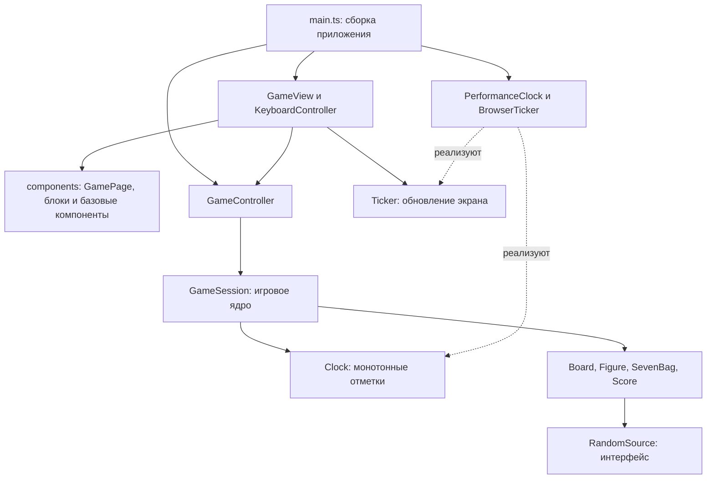

# Архитектура

Статус: архитектура целевой версии. Реализованы UI-основа и её тесты,
составные блоки, страница, начало/перезапуск партии и семь фигур с seven-bag.
Горизонтальное движение, проверка размещения и счётчик времени реализованы;
повороты, гравитация, подсчёт очков и хранилище ещё не подключены. Текущие границы —
в [new-game.md](new-game.md). Формат согласован: TypeScript + Vite,
локальный браузер; UI — Tailwind CSS и компоненты. Правила первой версии описаны
в [game-rules.md](game-rules.md), UI-контракты — в [ui-architecture.md](ui-architecture.md).

## Стек и локальный запуск

- TypeScript с `strict`: явные типы команд, состояний и результатов операций.
- Vite: локальный dev-сервер и сборка статических файлов.
- Tailwind CSS через Vite: токены и внутренние стили DOM-компонентов.
- Storybook для HTML/Vite: изолированные истории каждого компонента и блока.
- Vitest: интеграционные проверки ядра и адаптеров, небольшое число юнит-тестов.
- Playwright: пользовательские сценарии в реальном браузере.
- npm и закоммиченный `package-lock.json`: воспроизводимая установка через `npm ci`.

Для поля из 200 ячеек достаточно DOM. Компоненты — типизированные TypeScript-функции,
создающие DOM-элементы; отдельный UI-фреймворк не вводим. Классы отвечают за игровое
поведение и жизненный цикл. UI строится сначала из базовых компонентов, затем
из блоков и страницы; весь видимый текст создаётся через `Typography`.

В задаче настройки добавлены `npm run dev` с привязкой к `127.0.0.1`, `npm run build`,
`npm run preview`, `npm run storybook`, `npm run build-storybook`, проверка типов
и линтер. Команды тестов добавляются вместе
с соответствующей инфраструктурой и реальными сценариями. В README приведены
команды запуска и выбранная совместимая версия Node.js (24).

После установки зависимостей игра работает локально без сетевых запросов,
аккаунтов, сервера API и базы данных. Перезагрузка страницы начинает новую сессию;
сохраняется только рекорд.

## Слои и зависимости



`domain` знает только правила и данные. `application` вызывает ядро и координирует
часы и сохранение. Браузерные адаптеры реализуют интерфейсы. `main.ts` создаёт
объекты и связывает зависимости через конструкторы.

Папки создаются по мере появления кода:

```text
components/        # плоская библиотека: компоненты, блоки, GamePage и их stories
  Typography.ts
  Typography.stories.ts
  Wrapper.ts
  Wrapper.stories.ts
  theme.css        # Tailwind entry point и общие токены без overrides компонентов
.storybook/        # конфигурация HTML/Vite, общая тема и preview
src/
  domain/          # модели, правила, команды и снимок состояния
    figures/       # Figure, семь наследников и фабрика
  application/     # GameController и интерфейсы внешних зависимостей
  infrastructure/  # browser clock, random source, localStorage
  presentation/    # GameView и клавиатура: связывание UI с приложением
  main.ts          # создание и связывание объектов
tests/
  integration/     # взаимодействие реальных объектов
  unit/            # отдельные алгоритмы с полезными граничными примерами
  e2e/             # пользовательские сценарии Playwright
  fixtures/        # вручную заданные поля и последовательности фигур
docs/              # правила, архитектура, API, план и стратегия тестирования
```

## Объекты и ответственность

| Объект | Что делает | Чего не должен решать |
| --- | --- | --- |
| `Figure` | Абстрактный контракт фигуры, приватные клетки/позиция, общие moveLeft/moveRight/drop и создание кандидата | Столкновения, закрепление и начисление очков |
| `IFigure` … `LFigure` | Собственная геометрия и создание кандидата своего конкретного класса; в F03 — реализация rotate | Команды клавиатуры, поле и счёт |
| `createFigure` | Выбирает конкретный класс по типу из очереди | Правила движения и переходы партии |
| `Board` | Хранит закреплённые клетки; проверяет размещение, атомарно закрепляет фигуру, удаляет полные строки | Клавиши, время и выбор следующей фигуры |
| `SevenBag` | Выдаёт фигуры мешками по семь; предоставляет следующую без расходования очереди | Геометрию и UI |
| `Score` | Счёт, число линий, уровень и скорость по заданным правилам | Положение фигуры и часы |
| `GameSession` | Владеет полем, активной фигурой, очередью и счётом; применяет команды и время, поддерживает состояние партии | DOM, localStorage и `requestAnimationFrame` |
| `GameController` | Передаёт команды и время ядру, публикует снимок, управляет жизненным циклом адаптеров и записью рекорда | Дублирование игровых правил |
| `GameView` | Передаёт снимок в GamePage, обновляет компоненты без потери фокуса, связывает события и освобождает подписки | Собственные стилизованные блоки, изменение моделей и расчёт столкновений |
| `KeyboardController` | Преобразует нажатия в команды, управляет фокусом и подавлением прокрутки | Прямое редактирование поля |

Интерфейсы вводятся на границах с внешним миром:

- `RandomSource` — число в диапазоне `[0, 1)` для перемешивания мешка.
- `Clock` — чтение монотонной отметки в миллисекундах. PerformanceClock
  использует performance.now; GameSession получает часы через конструктор.
- `Ticker` — подписка на обновление представления с функцией отмены.
  BrowserTicker вызывает её раз в 250 мс; elapsedMs не зависит от числа callbacks.
- `HighScoreRepository` — чтение и сохранение рекорда; браузерная реализация
  изолирует формат localStorage и обработку ошибок.

Реализованы RandomSource с MathRandomSource и команды start/restart/moveLeft/moveRight.
GameController возвращает согласованный снимок; GameView преобразует его
в GameScreenData через gameScreen и вызывает GamePage.update. KeyboardController
подписан только на keydown/click своей области; dispose снимает оба обработчика.
Глобальных обработчиков и скрытых часов в ядре нет. GameView отменяет Ticker
при dispose, обновляет только время и сохраняет live-region статуса.
Хранилище и Score вводятся в соответствующих задачах. Рекорд сейчас равен 0; переданное контроллеру значение
не сбрасывается при начале новой партии. Границы движения — в [movement.md](movement.md).

Фигуры реализуют четыре принципа ООП через явную иерархию. Абстрактный Figure
предоставляет общий контракт; IFigure, OFigure, TFigure, SFigure, ZFigure,
JFigure и LFigure наследуют перемещение. Базовые методы вызывают переопределённый
createAt, поэтому кандидат сохраняет конкретный класс без проверок типа в игре.
Клетки, позиция и метаданные закрыты; массивы и точки выдаются копиями.
Фабрика — единственное место выбора между семью конкретными классами.

Геометрия хранится в соответствующих наследниках; отдельной таблицы тех же
матриц в production нет. Preview получает отделённые localCells новой фигуры
из фабрики. GameSession хранит Figure и принимает кандидата через Board.canPlace.
drop строит шаг вниз на одну клетку; игровой ввод падения и закрепление ещё
не подключены. В задаче №10 Figure получит abstract rotate, а каждый наследник —
свою реализацию: O сохранит положение, остальные используют согласованную
математику вращения. До этого этапа нет заглушек rotate.

Состояния партии представлены объединением
`ready | running | paused | gameOver`, отдельные классы состояний пока не нужны.
DI-контейнер, глобальный event bus и универсальный игровой движок не вводим.

## Изменение состояния

Публичные операции ядра: команды игрока, продвижение времени и получение снимка.
Перемещение и поворот сначала создают кандидата; `Board` проверяет допустимость,
после чего `GameSession` заменяет активную фигуру. Неудачная операция не меняет её.

При закреплении порядок один: перенести фигуру в поле → удалить полные строки →
начислить очки и обновить уровень → взять следующую фигуру → проверить её появление.
Наблюдатель получает один согласованный снимок после завершения операции.

Снимок содержит закреплённые клетки, клетки активной фигуры, следующую фигуру,
статус, счёт, линии, уровень и elapsedMs. Массивы копируются либо представлены неизменяемыми
значениями; внешний код не получает ссылки на изменяемое состояние.

Прошедшее время партии ядро вычисляет по внедрённому Clock; браузерные API
и Math.random из domain не вызываются. Стартовая отметка меняется только при
успешном создании новой партии. Правила отсчёта — в [score-and-time.md](score-and-time.md).
Будущая гравитация получит отдельное продвижение игрового времени; обновление
панели раз в 250 мс не является физическим игровым тиком. Пауза и её временная
база появятся в F08. Перезапуск не размножает подписки и обработчики событий.

## Риски и способы проверки

| Риск | Решение и проверка |
| --- | --- |
| Отрицательные индексы и выход за границы | Проверять все клетки до записи; сценарии у обеих стен и дна |
| Пропуск соседних полных строк | Удалять строки за одну операцию; явные примеры с 1–4 строками и неполными промежутками |
| Двойной цикл после паузы/рестарта | Один владелец часов, освобождение подписок; интеграционный сценарий и e2e |
| Тест сравнивает алгоритм с самим собой | Ожидаемые клетки и очки задавать по спецификации вручную |
| Недоступный localStorage ломает игру | Изолировать ошибку адаптером; проверять реальный отказ браузерного API |
| Ядро и видимое поле расходятся | E2e проверяет DOM после действий; сквозной сценарий старт → игра → проигрыш → рестарт |
| Tailwind работает в dev, но теряет стили в build | Полные статические имена классов и общая настройка для приложения/Storybook; проверять обе сборки |
| Страница обходит библиотеку стилями и текстом | Закрытые API, Typography, Wrapper и отдельные stories; ревью контрактов каждого компонента |

## Источники по инструментам

- [Классы TypeScript](https://www.typescriptlang.org/docs/handbook/2/classes.html)
- [Vite: dev-сервер и сборка](https://vite.dev/guide/)
- [Vitest: интеграция с Vite](https://vitest.dev/guide/)
- [Playwright: проверки пользовательского поведения](https://playwright.dev/docs/best-practices)

Версии зависимостей и требования к Node.js проверяем и фиксируем при настройке
проекта, а не выбираем по памяти на этапе проектирования.
